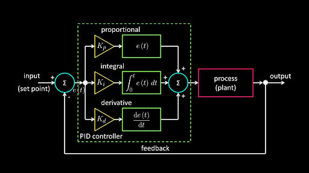
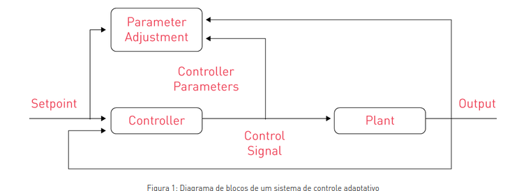

## python implementations 

Este repositorio é direcionado a implementações avulsas de python. avullsas no sentido de ser implementações para artificios de engenharia , como sistemas de controles, filtros , tecnicas de machine learnig , que fazem uso do ros2 para que possam ser reutilazdos em
outros projetos 

### sistemas de controle 
A implementação desse sistemas segue o diagrama abaixo

### sistema de controle adaptativo

(https://www-monolithicpower-com.translate.goog/en/learning/mpscholar/analog-vs-digital-control/advanced-topics-in-power-conversion-control/adaptive-control-techniques?_x_tr_sl=en&_x_tr_tl=pt&_x_tr_hl=pt&_x_tr_pto=tc)

### filtro de kalman# python_implementions
